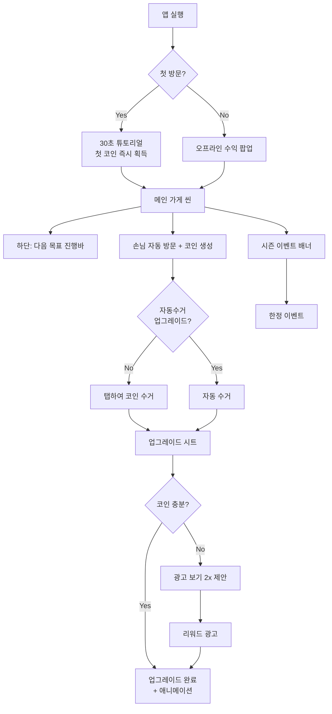

# 봄동타이쿤 (BomDong Tycoon) — Game Design Document

**Date:** 2026-03-16  
**Platform:** iOS  
**Genre:** Idle / Incremental Tycoon  
**Tech Stack:** SpriteKit + SwiftUI + Tuist  

---

## 1. Concept

봄동 (spring cabbage), a seasonal Korean vegetable trending in spring 2026, is the theme of this casual idle tycoon game. The player runs a 봄동 street food stall, hiring staff and upgrading the menu to earn more coins. The game is optimized for short commute sessions (2–15 minutes) on the subway or bus.

**Core fantasy:** Build a tiny 봄동 포장마차 into a famous 봄동 전문점 before summer ends.

---

## 2. Core Game Loop

```
Stall opens → Customers arrive (auto) → Staff serves them (idle)
→ Coins generated → Tap/auto collect
→ Spend coins on upgrades (staff / menu / location)
→ Offline: stall keeps running while app is closed (capped at 8 hours)
→ Return → collect offline earnings → reinvest
```

### Session Rhythm
| Session Length | Player Action |
|---|---|
| 2 min | Open → collect offline earnings → spend coins → close |
| 10–15 min | Watch rewarded ad for 2x boost → upgrade chain → unlock new dish |

---

## 3. Progression

### Upgrade Tiers (3 tiers each)

| Category | Tier 1 | Tier 2 | Tier 3 |
|---|---|---|---|
| **메뉴** | 겉절이 | 봄동김치 | 봄동비빔밥 |
| **직원** | 알바생 | 경력 아주머니 | 봄동 요리사 |
| **가게** | 포장마차 | 분식집 | 봄동 전문점 |
| **위치** | 골목 | 시장 | 강남 |

### Soft Progression Timeline
- **Day 1–3:** Single stall, 겉절이 only, manual coin collection
- **Day 4–7:** Hire first staff, unlock kimchi menu, auto-collect upgrade available
- **Week 2:** Second location unlocks
- **Week 4:** 봄동 season finale limited-time event

### Goal Bar
A persistent "next upgrade" progress bar is always visible at the bottom of the main scene:
> `알바생 고용까지 💰 340 / 500`

---

## 4. Season System

- Spring lasts **30 real days** → transitions to 여름 시즌
- In summer, 봄동 becomes a rare premium ingredient → bonus coin multiplier
- Creates FOMO and return visits each spring

---

## 5. Monetization

**Model:** Free + Rewarded Ads (Google AdMob)

| Ad Trigger | Reward |
|---|---|
| 2x offline earnings | Double collected amount |
| Instant upgrade unlock | Skip coin requirement |
| Revive after health inspector event | Continue streak |

No forced ads. All ads are player-initiated.

---

## 6. Retention Mechanics

- **Push notifications:** "가게가 꽉 찼어요! 봄동이 기다리고 있어요 🥬" (after ~2 hours offline)
- **Season events:** Limited-time rewards tied to real spring calendar
- **Goal bar:** Always shows next milestone — players never feel stuck

---

## 7. User Flow



---

## 8. Screens (5 total)

| Screen | Type | Purpose |
|---|---|---|
| **MainStallScene** | SpriteKit SKScene | Core gameplay |
| **UpgradeSheet** | SwiftUI bottom sheet | Upgrade management |
| **OfflineEarningsPopup** | SwiftUI overlay | On app foreground |
| **SeasonEventScene** | SpriteKit SKScene | Seasonal special content |
| **TutorialOverlay** | SwiftUI overlay | First launch only |

---

## 9. Technical Architecture

### Tuist Project Structure
```
BomDongTycoon/
├── App/                        # AppDelegate, entry point
├── Game/
│   ├── Scenes/                 # SpriteKit SKScenes
│   │   ├── MainStallScene
│   │   ├── UpgradeScene
│   │   └── SeasonEventScene
│   ├── Nodes/                  # SKNode subclasses
│   │   ├── CustomerNode
│   │   ├── StaffNode
│   │   └── BomDongNode (mascot)
│   ├── Systems/                # Game logic
│   │   ├── EarningsSystem
│   │   ├── OfflineProgressSystem
│   │   └── SeasonSystem
│   └── Models/                 # Data (Codable, persisted)
│       ├── StallState
│       ├── PlayerProgress
│       └── SeasonState
├── UI/                         # SwiftUI overlays (HUD, menus)
└── Resources/                  # Assets, sounds
```

### Key Technical Decisions
| Concern | Decision |
|---|---|
| Persistence | `UserDefaults` + `Codable` structs |
| Offline earnings | `Date` diff on foreground, capped at 8 hours |
| Ads | Google AdMob rewarded ads via SPM |
| Modules | `GameCore`, `GameUI`, `App` targets via Tuist |

### Required Skills for Implementation
- `axiom-ios-games` — SpriteKit scene graphs, ECS, game loop patterns

---

## 10. Visual Style

- **Art direction:** Cute/chibi Korean characters, pastel spring palette
- **Mascot:** 봄동 as an adorable anthropomorphic spring cabbage
- **Color palette:** Soft greens, warm yellows, spring pinks
- **Vibe:** 모여봐요 동물의숲 meets Korean street food market
