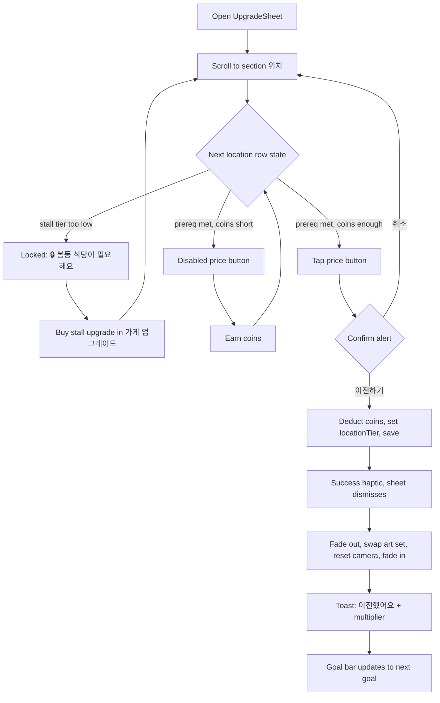

# Location Tiers (위치) - Design Spec

Branch: `location-tiers-design` | Date: 2026-10-12 | Owner: designer -> ios-developer, 2.5d-art-director

## 1. What a location IS

**One persisted integer, `locationTier` 0...2, that acts as a sale-price multiplier and gates nothing else.**

| Tier | Name | Price (coins) | Requires | Sale-price multiplier |
|---|---|---|---|---|
| 0 | 골목 | free (start) | - | x1.0 |
| 1 | 시장 | 40,000 | stall tier >= 1 (봄동 식당) | x2.0 |
| 2 | 강남 | 200,000 | stall tier >= 2 (봄동 전문점) | x4.0 |

Reasoning:
- One number is the whole mechanic. It multiplies revenue per sale, exactly where the existing stall/menu
  income is computed, so every income path (live, offline, ads) inherits it with no special cases.
- A flat multiplier is a bigger felt step than another +N% tier: x2 and x4 are visible on the very next
  customer's coin pop, which is what makes it read as "a new place" and not "another upgrade".
- Prices sit above the current ceiling (25,000). 시장 at 40,000 is 1.6x the 전문점; 강남 at 200,000 is 5x the
  시장, mirroring the 5x-8x steps of the stall and farm ladders. Rule for tuning: a location should repay
  itself in ~15 min of active play at the income the player has when first able to afford it. If playtests
  disagree, change only the price column; the multipliers are the identity of the feature.
- Stall-tier gating makes the order obvious (식당 -> 시장, 전문점 -> 강남) and means a player never
  moves a plastic-tarp 포장마차 to Gangnam. Prerequisite is one `stallTier >= locationTier` comparison.
- No location-specific menu, staff or customer-rate mechanics in v1. Customer mix is cosmetic only.
- Not reversible. There is no "move back"; ownership is a single forward-only integer.

Data shape (dev guidance, not Swift):
```
LocationDef { tier: Int, nameKo: String, price: Int, requiredStallTier: Int, saleMultiplier: Double }
static table of 3 defs; everything below reads from it so a 4th location is a one-row change.
```

## 2. Purchase flow in UpgradeSheet

New **Section "위치"** placed **last** in the List (after "가게 업그레이드"). Header "위치",
footer: "이전해도 가게와 직원은 그대로 따라와요."

All three rows are always visible (never hide the future; it is the goal).

| State | Applies to | Look | Trailing |
|---|---|---|---|
| Owned / current | tier == locationTier | name + description; green effect line; small `checkmark.circle.fill` and "현재 위치" capsule | none |
| Past | tier < locationTier | same as owned but dimmed 60%, no capsule | `checkmark` |
| Next, affordable | tier == locationTier+1, prereq met, coins >= price | full opacity | blue prominent button "💰 40,000" |
| Next, short of coins | same but coins < price | full opacity | disabled-style button, price in secondary color; effect line stays green |
| Locked (prereq) | prereq not met | 50% opacity, `lock.fill` | none; blue-less line "🔒 봄동 식당이 필요해요" in orange/secondary |
| Locked (queue) | tier > locationTier+1 | 50% opacity | none; line "🔒 시장에 먼저 이전하세요" |

Row anatomy follows existing rows: name (headline), description (subheadline, secondary), green effect line
("판매 수익 x2"), blue "🔓" line, trailing button. Min row height 44pt; button hit area >= 44x44.

Purchase sequence (next + affordable):
1. Tap price button -> **confirmation alert** (locations are the only upgrades with a confirm; the price is
   a big one-time spend and the action reshapes the scene).
   Title "시장으로 이전할까요?" Message "💰 40,000을 내고 이전하면 판매 수익이 2배가 돼요."
   Buttons "이전하기" (default) / "취소".
2. On confirm: deduct coins, set `locationTier`, save immediately, success haptic (`.success`).
3. Sheet dismisses (it would otherwise hide the payoff).
4. **Scene transition, not an instant swap** (about 1.2 s total):
   - 0.0-0.35 s: customer spawning pauses; scene fades to the existing sky/background color (ease-in).
   - 0.35 s: swap location art set, reset camera to shop center, clear in-flight customers (they are only
     visuals; coins already credited).
   - 0.35-0.8 s: fade in (ease-out). Shop fades in with a short 0.95 -> 1.0 scale settle.
   - 0.8 s: spawning resumes; toast slides from top (see copy), holds 2.5 s.
5. HUD goal bar refreshes to the next goal.
Reduce Motion: skip fade/scale, do a 0.2 s cross-dissolve.

## 3. Scene art brief (for 2.5d-art-director)

The shop (3x3, tiered enclosure), prep table, counter, farm ring and customers already exist and are
**unchanged**. A location only changes what is *around* the shop. Design principle: each place must be
identifiable from silhouette and color temperature alone at the size it is drawn.

| | 골목 (alley) | 시장 (market) | 강남 (Gangnam) |
|---|---|---|---|
| Mood | narrow, dim, quiet, brick and tin | busy, warm, canvas and wood, colorful | tall, cool, glass and neon, polished |
| Palette | grey brick, rusty red, dull warm light | stall-awning red/yellow/green, warm wood | steel blue, glass cyan, neon magenta accents |

### MUST (minimum that still reads as 3 places): 9 pieces

| # | Piece | Description | Priority |
|---|---|---|---|
| 1-3 | `backdrop_back_left` x3 (one per location) | Long wall along the back-left edge behind the shop. Alley: stacked brick tenement wall with a window and a drainpipe. Market: row of covered market stalls seen from behind, striped awnings. Gangnam: glass office tower facade with reflections. | must |
| 4-6 | `backdrop_back_right` x3 | Matching piece along the back-right edge so the corner closes. Same family per location; no shared seam elements, so pieces can be tiled or stretched without a visible break. | must |
| 7-9 | `ground_road` x3 | Retextured road/ground tile that customers walk along (same footprint as the current road tile). Alley: cracked concrete with a drain. Market: worn flagstone with straw/crate litter. Gangnam: clean pale paving with a lane-marking stripe. | must |

Sizes: art director sets dimensions in grid units; keep each backdrop piece taller than the shop
roofline so the shop is not swallowed, and keep the front/east road edge clear (customers enter there).

### NICE (ship later; each is independent)

| Piece | Location | Description | Priority |
|---|---|---|---|
| `prop_hanging_lanterns` | 골목 | A string of red paper lanterns over the entrance | nice |
| `prop_bicycle_bins` | 골목 | Parked bicycle and two trash bins at the wall | nice |
| `prop_crates_produce` | 시장 | Stacked crates of cabbages next to the shop | nice |
| `prop_banner_flags` | 시장 | Festival bunting across the back wall | nice |
| `prop_neon_sign` | 강남 | Glowing hanging sign with a 봄동 leaf icon | nice |
| `prop_street_lamp` | 강남 | Modern lamp post at the road edge | nice |
| Customer palette swaps | 시장 / 강남 | Existing customer sprites recolored: aprons and shopping bags (시장), suits and coats (강남) | nice |

Fallback if art is late: ship the 3 ground retints plus a flat tinted backdrop strip per location; the
toast and the goal bar carry the identity. Do not block the feature on the nice list.

Season: seasonal tint/particles apply on top of whichever set is active. Art must be authored in neutral
daylight; no baked season.

## 4. Season and goal bar

- Season and location are fully independent. Season banner text becomes "{계절} · {위치}", e.g.
  "봄 · 시장". Season effects (tint, petals, snow) overlay all three sets unchanged.
- No season-specific location gameplay in v1.
- Goal bar: the location is a candidate goal **only when its stall prerequisite is met**. The bar always
  shows the cheapest remaining goal among all upgrade types; a location competes by price like any other.

| Situation | Goal-bar text |
|---|---|
| Next goal is a location, coins short | "다음 목표까지 💰 340 / 40,000 · 시장 이전" |
| Location prerequisite unmet and nothing else left | "다음 목표: 봄동 식당으로 시장 이전을 준비하세요" |
| Location affordable | "시장으로 이전할 수 있어요! 탭해서 확인" (tap opens UpgradeSheet scrolled to 위치) |
| Max location reached, other goals remain | existing text |
| Everything bought | "🎉 강남에서 봄동 제국을 완성했어요!" |

## 5. Korean copy

Section: header `위치`; footer `이전해도 가게와 직원은 그대로 따라와요.`

| Row | 이름 | 설명 | 효과 (green) | 해금 (blue) | 잠금 |
|---|---|---|---|---|---|
| 0 | 골목 | 한적한 골목 어귀, 봄동 장사의 시작 | 판매 수익 x1 | - | - |
| 1 | 시장 | 사람 북적이는 전통시장 한복판 | 판매 수익 x2 | 🔓 시장 풍경과 새 손님 | 🔒 봄동 식당이 필요해요 |
| 2 | 강남 | 유동 인구 가득한 강남 대로변 | 판매 수익 x4 | 🔓 강남 풍경과 새 손님 | 🔒 봄동 전문점이 필요해요 |

Queue lock (tier above next): `🔒 시장에 먼저 이전하세요`
Owned capsule: `현재 위치`

Confirm alert (per location; `{n}` is the multiplier):
- Title `{위치}(으)로 이전할까요?`  (use the particle-correct forms: "시장으로", "강남으로")
- Message `💰 {가격}을 내고 이전하면 판매 수익이 {n}배가 돼요.`
- Buttons `이전하기` / `취소`

Toast after transition:
- 시장: `🏪 시장으로 이전했어요! 판매 수익 x2`
- 강남: `🌆 강남으로 이전했어요! 판매 수익 x4`

VoiceOver: row label "{이름}, {설명}"; value "현재 위치" / "{가격} 코인, 이전 가능" / "잠금, {조건}".
Announce after transition: "{위치}로 이전했습니다. 판매 수익 {n}배."
Dynamic Type: description and effect lines wrap (no truncation); button may drop under the title at
accessibility sizes, as existing rows do.

## 6. Edge cases

| Case | Behavior |
|---|---|
| Old save has no `locationTier` | Optional with default 0 (골목, x1.0). Nothing changes for existing players; the "위치" section simply appears. |
| Invalid stored value (negative / > 2) | Clamp to 0...2 on load. |
| Save with stall tier already 1 or 2 | Rows 시장 / 강남 are immediately purchasable when coins allow; no migration or free grant. |
| Offline earnings | Location cannot change while the app is closed, so offline income uses the saved tier's multiplier. Same 8 h cap. |
| Purchase while earnings are queued/just credited | Multiplier applies to sales after the purchase only; no retroactive adjustment. |
| Rewarded ad: 2x offline | Stacks multiplicatively with location, unchanged. |
| Rewarded ad: instant upgrade | **Excluded for locations.** The 200,000 purchase is the long-term goal; an ad skip would trivialize it and the alert flow. Ad button hidden on location rows. |
| Backgrounded mid-transition | Tier is saved before the animation starts; on resume, show the final state with no replay. |
| Purchase tapped twice / double-fire | Disable button after the alert confirms; guard on `coins >= price && tier == locationTier+1`. |
| Camera was panned away | Transition resets camera to shop center. |
| Max tier | Row 강남 shows owned state; no further CTA; goal bar falls through to other goals. |
| Adding a 4th location later | Append a row to the table plus art set; no migration. |

## 7. Unlock flow



## Acceptance checklist for ios-developer

- [ ] `locationTier` optional/defaulted in the Codable save; clamped on load
- [ ] Multiplier applied in the single sale-income path; offline path verified to use it
- [ ] "위치" section last in UpgradeSheet, 3 rows, all 6 states
- [ ] Alert confirm; success haptic; sheet dismiss; transition with Reduce Motion fallback
- [ ] Goal bar and season banner copy per section 4
- [ ] Instant-upgrade ad hidden on location rows
- [ ] Art swap goes through `tools/isorender/install.py` (asset catalog stale-build gotcha)
