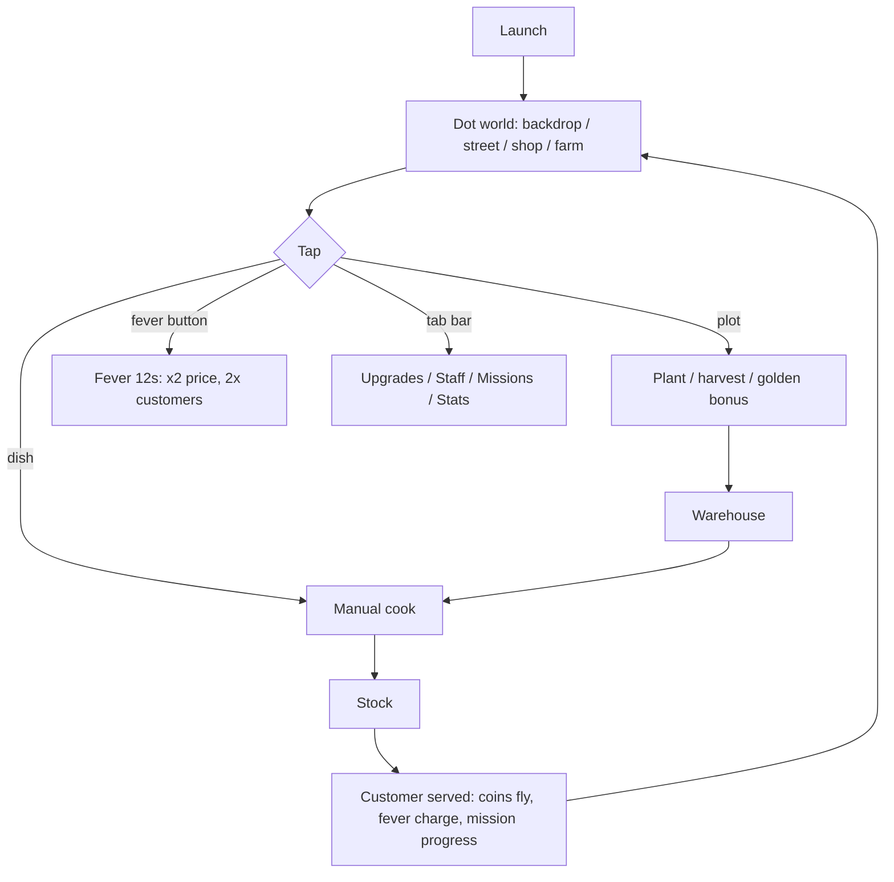

# BomDong Tycoon 3.0.0 — "Dot World"

Full recreation of the game's presentation and feel in **2D dot (pixel) art**, on top of the
existing, tested economy in `GameCore`. Existing saves must keep loading (same UserDefaults
keys, tolerant decoding). Branch: `dot-world-3-0`.

## Pillars

1. **Everything is dots.** Front-facing 3/4 top-down pixel art (classic farm-RPG view), one
   shared palette, 1 art pixel = an integer number of screen points, nearest-neighbour only.
   No isometric projection, no emoji art, no blurred scaling anywhere.
2. **The world is alive.** Crops sway, customers walk in with an order bubble, cooks stir,
   coins fly to the HUD, rain falls, day turns to dusk.
3. **Active play is rewarded, idle play still works.** New fun layer: fever, golden bomdong,
   rain, gourmet (VIP) customers, daily missions.
4. **Same economy underneath.** Prices, costs, tiers, staff, warehouse, locations and prestige
   are unchanged; new multipliers compose in `EarningsSystem.salePrice` only.

## Screen (portrait, fixed camera, one screen — no panning)

World is **144 art px wide** (9 tiles of 16). Scale = floor(viewWidth / 144) points per art
pixel (2 on 320–431pt, 3 on ≥432pt is too coarse a jump, so: scale = viewWidth / 144 rounded
down to the nearest 0.5, min 2; textures stay `.nearest`). The world is centred horizontally;
leftover margin is filled by the repeating ground/backdrop. Bands top → bottom:

| Band | Height (art px) | Contents |
|---|---|---|
| Backdrop | 56 | location skyline (골목 / 시장 / 강남), sky tint by time of day, clouds, rain |
| Street | 32 | customers walk in from right, queue (max 3) at the counter, leave left |
| Shop | 64 | building for stallTier 0/1/2, counter + cashier, 3 cook stations (menu 0–2) with dish, cook figure, progress bar, stock count |
| Yard | 24 | warehouse crate (count / capacity), path, decorations |
| Farm | 72+ | plots in a 5-column grid (max 10 = 5×2), each 24×24, plus an "add plot" sign cell |

The SwiftUI HUD sits above (coins, rating, goal, fever gauge) and a pixel tab bar below
(업그레이드 / 직원 / 미션 / 기록). The scene lays bands out between the safe areas; on tall
screens extra height goes to the backdrop (top) and grass below the farm.

### Interactions

- Tap empty plot → plant (seed cost). Tap ripe plot → harvest (+pop, cabbage flies to crate).
  Tap **golden** ripe plot → harvest + coin burst bonus.
- Tap a cook station dish → manual cook (existing `startManualCook`).
- Tap warehouse crate → expand confirmation (existing cost table). Tap add-plot sign → existing
  `AddFarmPlotConfirmation`.
- Tap fever button when the gauge is full → fever.
- Staff are assigned through the staff sheet as today; assigned staff appear as figures.

## New GameCore systems (all pure + unit tested; RNG injected)

| System | Rule | Persistence |
|---|---|---|
| `FeverSystem` | Each served customer adds charge (`1/10`, ×1.5 if waited < 2 s). Charge decays 1/60 per s after 6 s without a sale. At full charge `store.startFever()` → 12 s: sale price ×2, customer spawn interval ×0.5. Gauge empties while active. | transient |
| Golden bomdong | When a plot ripens, 6% chance (`FarmPlot.isGolden`). **Manual** harvest of a golden plot pays `goldenBonus = 15 × salePrice(best unlocked menu)` straight to coins (counts in `totalEarned`), plus the normal yield. Worker auto-harvest takes it as a normal crop. | `FarmPlot.isGolden` (tolerant, default false) |
| `WeatherSystem` | Clear ↔ rain. Next rain 150–300 s after the last ended; lasts 30 s; growth ×2 while raining. | transient |
| Gourmet customer | Spawner rolls 8% (only when rating ≥ 3.0). `sellItem(menuIndex:isGourmet:)` pays ×3; `recordServed(waitTime:isGourmet:)` gives double the rating gain, `recordFailed(isGourmet:)` double the loss. | none |
| `MissionSystem` | 3 daily missions drawn from a seeded-by-date pool: serve N customers / harvest N / earn N coins / cook N / trigger fever N / serve N gourmets. Targets scale with stall tier; reward = `max(100, 90 × earningRate)` coins each, claim by tap. Resets at local midnight. | `MissionState` blob (new key `missions`, tolerant) |
| Time of day | Purely visual: 4-minute loop morning → noon → dusk → night, from `totalPlaySeconds`. | none |

`salePrice` gains a trailing `feverMultiplier: Double = 1` composed once; `coinsPerSecond`
and offline earnings never include fever/gourmet/golden (they are active-play bonuses).

## Art pipeline: `tools/dotart/`

Python + Pillow. Sprites are ASCII grids + a single named palette in source; the script emits
1×-art-pixel PNGs into `Resources/Assets.xcassets/Dot/` (one imageset per frame, universal 1x,
name `dot_<group>_<name>[_<frame>]`), a `tools/dotart/out/contact_sheet.png` at ×6 for
review, and clears the cached asset-catalog output (see CLAUDE.md gotcha). SFX are synthesized
8-bit `.wav` files by `tools/dotart/sfx.py` into `Resources/Sounds/`.

The sprite manifest (exact names + pixel sizes) lives in `tools/dotart/MANIFEST.md`; the scene
code depends on those names only.

## Phases (each lands as its own commits)

1. **Art** — `tools/dotart`, full sprite set, SFX, manifest. ∥ **Core** — the systems above + tests.
2. **Scene** — `DotWorldScene` replaces `MainStallScene` and every isometric node; old nodes and
   old imagesets deleted.
3. **UI** — pixel theme (Galmuri font, 9-slice panels), HUD, tab bar, sheets restyled, missions
   sheet, fever button, sound toggle, new app icon + splash; ko/en strings.
4. **QA** — simulator play-through with screenshots, fix loop.
5. **PR** — feature PR to `main`; `3.0.0` release branch only after merge.

